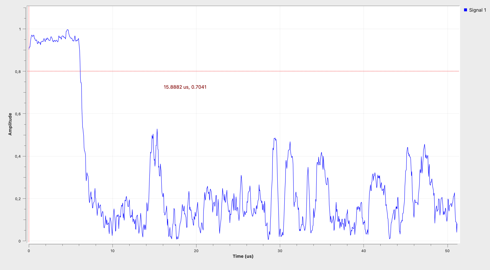
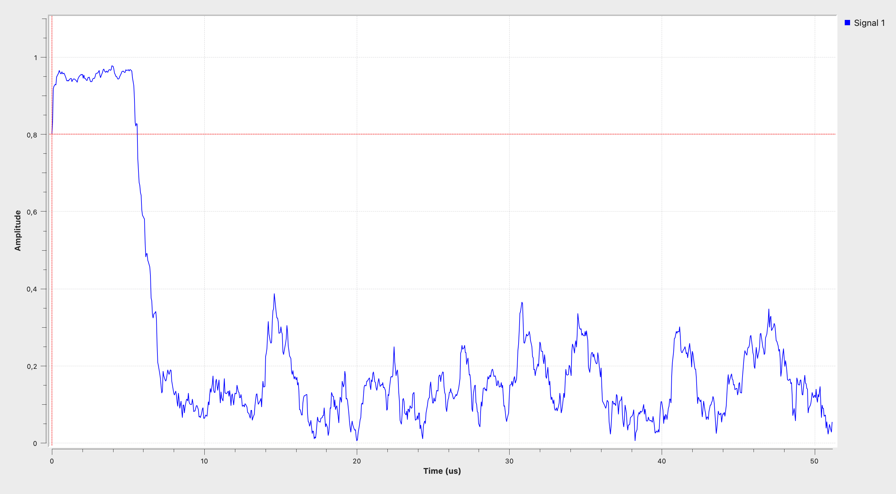
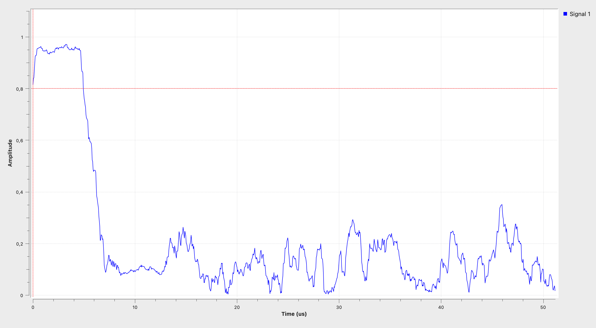

# SDR-PROJECT

Implementation of an **IEEE 802.11a OFDM receiver in GNU Radio**.

The receiver is developed progressively following the project guide and the receiver architecture presented in the reference paper. The first step is the detection of the beginning of an IEEE 802.11a frame using the periodicity of the short training sequence.

---

# Week 1 — IEEE 802.11a Parameters and Frame Detection

## 1. IEEE 802.11a OFDM Parameters

The first objective was to identify the main parameters of the IEEE 802.11a OFDM physical layer.

| Parameter | Value |
|---|---:|
| Channel bandwidth | 20 MHz |
| Sampling rate | 20 MS/s |
| FFT/IFFT size | 64 |
| Subcarrier spacing | 312.5 kHz |
| Total number of subcarriers | 64 |
| Used subcarriers | 52 |
| Data subcarriers | 48 |
| Pilot subcarriers | 4 |
| Useful OFDM symbol duration | 3.2 µs |
| Cyclic prefix duration | 0.8 µs |
| Total OFDM symbol duration | 4 µs |
| Useful symbol length | 64 samples |
| Cyclic prefix length | 16 samples |
| Total symbol length | 80 samples |

### Subcarrier spacing

The subcarrier spacing is obtained from:

**Δf = fs / NFFT**

With:

- fs = 20 MHz
- NFFT = 64

Therefore:

**Δf = 20 MHz / 64 = 312.5 kHz**

### Symbol duration

At a sampling rate of 20 MS/s, the sampling period is:

**Ts = 1 / fs = 50 ns**

The useful OFDM symbol contains 64 samples:

**64 × 50 ns = 3.2 µs**

The cyclic prefix contains 16 samples:

**16 × 50 ns = 0.8 µs**

Therefore, a complete OFDM symbol contains 80 samples and lasts:

**80 × 50 ns = 4 µs**

### Why are some subcarriers unused?

Not all 64 FFT bins carry useful information.

Among the 64 subcarriers:

- 48 carry data;
- 4 are pilot subcarriers;
- the remaining subcarriers are unused.

The unused subcarriers include the **DC subcarrier**, located at the center of the spectrum, and **guard subcarriers** located at the edges of the OFDM channel.

The guard subcarriers provide spectral separation from neighbouring channels, while the DC subcarrier is not used for data transmission.

---

## 2. IEEE 802.11a Frame Preamble

An IEEE 802.11a frame starts with a known preamble used by the receiver for detection and synchronization.

The first part is the **Short Training Field (STF)**.

The STF contains a **16-sample pattern repeated 10 times**.

Its total length is therefore:

**10 × 16 = 160 samples**

At 20 MS/s:

**160 × 50 ns = 8 µs**

The important property for frame detection is the periodicity of the STF:

**s[n] ≈ s[n + 16]**

During the STF, the received signal is therefore strongly correlated with a copy of itself delayed by 16 samples.

This property is used for frame detection.

---

## 3. GNU Radio Stream Tags — Section 2.1

GNU Radio stream tags are metadata attached directly to samples in a data stream. They can contain information such as the sampling frequency, carrier frequency or timestamps.

In the IEEE 802.11 receiver, tags are also used to propagate information about the received frame through the processing chain.

The OFDM Sync Long block determines the symbol alignment and tags the first OFDM symbol of each frame. This allows the following blocks to identify the beginning of the frame.

Later, after decoding the SIGNAL field, the OFDM Decode Signal block adds another tag containing the frame encoding scheme and frame length. This information is then used by the following decoding block to correctly process the payload.

Therefore, the tags mentioned in Section 2.1 are not separate blocks visible in the GNU Radio flowgraph. They are metadata attached to the sample stream and are generated and used by the synchronization and decoding blocks.

### Where are the mentioned tags?

Stream tags are **not separate signal connections in the GNU Radio flowgraph**.

Instead, they are attached to particular samples in the stream. They can be generated by a source or processing block, propagated through the receiver and read or modified by downstream blocks.

Therefore, there is no separate "tag wire" visible in GNU Radio Companion. The tags travel together with the sample stream.

For Week 1, the main objective is the processing of the complex I/Q samples. Tags become particularly useful when synchronization and frame information have to be propagated between later stages of the receiver.

---

# 4. Frame Detection — Section 2.2

The objective of Section 2.2 is to detect the short training sequence at the beginning of an IEEE 802.11a frame.

Since the STF repeats every 16 samples, the received signal is compared with a delayed version of itself.

## 4.1 Autocorrelation

The autocorrelation is calculated as:

**a[n] = sum of s[n+k] × conjugate(s[n+k+16]) over NWin samples**

where:

- s[n] is the received complex baseband signal;
- 16 is the repetition period of the short training sequence;
- NWin is the integration window length;
- conjugate(.) represents the complex conjugate.

During the STF:

**s[n] ≈ s[n + 16]**

Therefore, the magnitude of the autocorrelation becomes large.

### GNU Radio blocks used for the autocorrelation

The autocorrelation branch of the Week 1 flowgraph is implemented using:

**Delay (16) → Complex Conjugate → Multiply → Moving Sum → Complex to Mag**

In the implemented flowgraph, the moving sum is obtained using a FIR filter with:

```text
Taps = [1] * window_size
Decimation = 1
```

This performs the summation over the selected NWin samples.

---

## 4.2 Signal Power

The received signal power is calculated over the same integration window:

**p[n] = sum of |s[n+k]|² over NWin samples**

### GNU Radio blocks used for the power

The corresponding branch is:

**Complex to Mag² → Moving Sum**

The moving sum is again implemented using a FIR filter with:

```text
Taps = [1] * window_size
Decimation = 1
```

---

## 4.3 Normalized Autocorrelation

The autocorrelation is normalized using the received power:

**c[n] = |a[n]| / p[n]**

The normalization is important because detection should mainly depend on the **periodicity of the received signal**, rather than only on its absolute amplitude.

When the 16-sample repetition is present:

**c[n] approaches 1**

Outside the short training sequence, this periodicity is absent and the normalized autocorrelation becomes significantly smaller.

A plateau close to 1 can therefore be used to identify the beginning of an IEEE 802.11a frame.

---

# 5. GNU Radio Implementation

For offline receiver development, a provided recording of real IEEE 802.11a baseband I/Q samples was used.

The experiment presented here uses:

```text
Sample1_20MHz_Channel36.bin
```

The recording has a sampling rate of:

**fs = 20 MS/s**

The input chain is:

**File Source → Throttle**

The `Throttle` block is configured at 20 MS/s to prevent the file from being processed as fast as the computer allows.

The signal is then divided into two branches:

### Autocorrelation branch

**Signal → Delay (16) → Complex Conjugate → Multiply → Moving Sum → Complex to Mag**

### Power branch

**Signal → Complex to Mag² → Moving Sum**

Finally, the two quantities are divided:

**c[n] = |a[n]| / p[n]**

The result is displayed using a `QT GUI Time Sink`.

The complete GNU Radio flowgraph is available in:

```text
Week1/week1_frame_detection.grc
```

---

# 6. Frame Detection Results

The next experiment investigates the effect of the integration-window length **NWin**.

Three values were tested:

- NWin = 32
- NWin = 48
- NWin = 64

A threshold of **0.8** is displayed in red on the figures to make the high-correlation region easier to identify.

The horizontal axis is expressed in time.

Since the sampling rate is 20 MHz:

**1 sample = 0.05 µs**

The absolute horizontal position of the plateau does not need to be identical to Figure 2 of the reference paper. The QT GUI Time Sink displays a selected portion of the sample stream, so the origin of the displayed time axis depends on the displayed window.

The important observations are the **high normalized correlation during the repeated training sequence and the clear decrease when the periodic structure ends**.

---

## 6.1 NWin = 32



With **NWin = 32**, a clear high-correlation region appears at the beginning of the displayed interval.

The normalized autocorrelation remains approximately between 0.9 and 1 during the plateau and is therefore clearly above the detection threshold of 0.8.

When the repeated short-training structure ends, the correlation decreases sharply below the threshold.

However, after this transition, relatively large fluctuations remain visible. Several peaks can be observed outside the high-correlation region.

This is consistent with the use of a shorter integration window. Fewer samples contribute to each correlation estimate, providing good temporal localization but less averaging of local variations.

---

## 6.2 NWin = 48



With **NWin = 48**, the beginning of the displayed interval again produces a very clear plateau close to 1.

The normalized autocorrelation remains well above the 0.8 threshold during this region and then falls rapidly below the threshold.

Compared with NWin = 32, the values outside the high-correlation region are generally less irregular.

The separation between the detected region and the rest of the signal is therefore very clear.

NWin = 48 provides a good compromise between:

- maintaining a clearly localized transition;
- reducing fluctuations;
- obtaining a stable high-correlation plateau.

For this reason, **NWin = 48 is retained for the final Week 1 implementation**.

This is also the integration-window value reported as working well in the reference receiver implementation.

---

## 6.3 NWin = 64



With **NWin = 64**, the high-correlation region remains clearly visible and reaches values close to 1.

Increasing the integration window means that more samples contribute to each correlation estimate.

The values outside the plateau are generally smoother and the fluctuations are reduced compared with the shorter integration window.

However, using a larger window also increases temporal averaging. The transitions are therefore averaged over a larger number of samples.

NWin = 64 provides stronger smoothing, but with reduced temporal localization compared with a shorter integration window.

---

# 7. Comparison of NWin

The three experiments illustrate the trade-off introduced by the integration-window length.

| NWin | Main observation |
|---:|---|
| 32 | Good temporal localization, but larger fluctuations outside the STF |
| 48 | Clear plateau and good compromise between smoothing and localization |
| 64 | Stronger smoothing, but more temporal averaging |

The experiments show why an intermediate integration-window length is useful.

The final Week 1 implementation therefore uses:

**NWin = 48**

---

# 8. Week 1 Conclusion

Week 1 established the main parameters of the IEEE 802.11a OFDM physical layer and implemented the first operation of the receiver: **frame detection**.

The 16-sample periodicity of the Short Training Field allows the beginning of a frame to be detected using normalized autocorrelation.

The GNU Radio implementation computes:

1. the correlation between the received signal and a version delayed by 16 samples;
2. the received power over the same integration window;
3. the normalized metric:

**c[n] = |a[n]| / p[n]**

Using the provided 20 MHz IEEE 802.11a I/Q recording, a clear high-correlation plateau was obtained.

The influence of the integration-window length was investigated experimentally using NWin = 32, 48 and 64.

The results show that increasing NWin provides stronger averaging, while a shorter window provides better temporal localization.

Based on these results, **NWin = 48** is retained as a good compromise for the following receiver stages.

---
# Week 2 — IEEE 802.11a Frame Synchronization and Short Sync Block

## 1. Introduction to the OFDM Sync Short Block

Following the frame detection phase established in Week 1, the next objective is to use the normalized autocorrelation metric for automatic frame detection with the **OFDM Sync Short** block (or WiFi Sync Short).

In Week 1, the normalized autocorrelation metric $c[n]$ was calculated and visualized in order to identify the characteristic plateau produced by the Short Training Field (STF). In Week 2, this metric is used by the OFDM Sync Short block to automatically detect the presence of an IEEE 802.11a frame and control which samples are forwarded to the next stages of the receiver.

---

## 2. Understanding the OFDM Sync Short Block

The **OFDM Sync Short** block performs the first synchronization step of the receiver.

The Short Training Field contains a 16-sample pattern that is repeated several times. Because of this periodic structure, the normalized autocorrelation $c[n]$ becomes high during the STF and produces a plateau.

The block performs the following functions:

* **Frame Detection:** It monitors the normalized autocorrelation metric $c[n]$ calculated by the previous blocks.
* **Threshold Decision:** It checks whether the correlation remains sufficiently high to identify a plateau corresponding to the Short Training Field.
* **Sample Forwarding:** The block acts as a valve. When a frame is detected, a fixed number of samples are forwarded to the following receiver stages. Otherwise, samples are discarded.
* **Tag Generation:** In our GNU Radio flowgraph, the output is connected to a Tag Debug block, allowing the `wifi_start` events generated during frame detection to be observed.

The OFDM Sync Short block therefore provides a coarse frame detection stage. More precise symbol alignment is performed later by the long synchronization stage.

---

## 3. Meaning of the Threshold Parameters

The behavior of the synchronization block depends strongly on its detection parameters.

### Threshold

The **Threshold** defines the correlation level required for a sample to contribute to the detection of a valid plateau.

A lower threshold makes the detector more permissive, while a higher threshold makes it more selective.

### Min Plateau

The **Min Plateau** parameter is used to ensure that the threshold condition persists before a frame is detected. This prevents an isolated correlation peak from immediately triggering the detector.

The paper describes the detection of a plateau using consecutive samples above a configurable threshold. In our GNU Radio flowgraph, the **Min Plateau** parameter is set to 2.

---

## 4. Exploration of Threshold Sensitivity

Different threshold values were tested in order to observe their influence on the behavior of the OFDM Sync Short block.

### 4.1 Increasing the Threshold

When the threshold is increased, the detector becomes more selective. A higher correlation value is required before a frame can be detected.

During our tests, increasing the threshold reduced the number of detected `wifi_start` events. If the threshold becomes too high, the detector can fail to detect frames whose correlation plateau does not reach the required level.

Therefore, a threshold that is too high can lead to **missed frame detections**.

### 4.2 Decreasing the Threshold

When the threshold is decreased, the detector becomes more permissive because lower correlation values can satisfy the detection condition.

This increases the possibility that fluctuations that do not correspond to a valid Short Training Field satisfy the detection condition.

Therefore, a threshold that is too low can increase the risk of **false detections**.

### 4.3 Threshold Trade-Off

The threshold must therefore provide a compromise between sensitivity and selectivity:

* **Lower threshold:** more permissive detection, with a higher risk of false detections.
* **Higher threshold:** more selective detection, with a higher risk of missing weaker frames.

The paper does not specify a single optimal numerical threshold. The appropriate value depends on the received signal and channel conditions.

---

## 5. Limitations and Breakdown Scenarios

Despite its simplicity and low computational cost, the autocorrelation-based frame detection method has several limitations.

### 5.1 Fixed Number of Forwarded Samples

After detecting a frame, the OFDM Sync Short block forwards a **fixed number of samples**.

This means that the maximum frame size that can be processed is limited by the number of samples forwarded by the block.

### 5.2 Closely Spaced Frames

Another limitation occurs when a second frame arrives shortly after the first detected frame.

While the block is still forwarding the samples associated with the first frame, a new frame can be missed. The paper specifically describes this problem for a **CTS (Clear To Send) frame following an RTS (Request To Send) frame**. In this situation, the receiver can remain synchronized to the preceding RTS and fail to detect the following CTS.

This demonstrates that the approach can have difficulties with closely spaced frames.

### 5.3 Autocorrelation Detection

The paper also mentions that **matched filtering** could provide more robust detection of the known training sequence. However, matched filtering requires significantly more computation.

For this reason, the receiver uses the computationally simpler autocorrelation method for the initial frame detection stage.

---

## 6. Week 2 Conclusion

Week 2 extended the frame detection system developed during Week 1 by integrating the **OFDM Sync Short** block.

The normalized autocorrelation metric $c[n]$ is now used to automatically detect the Short Training Field and determine when samples should be forwarded to the next stages of the receiver.

Changing the detection threshold showed the expected trade-off between permissive and selective detection. Increasing the threshold makes the detector more selective, while decreasing it makes the detector more permissive.

The main limitations of this approach are the fixed number of forwarded samples and the possibility of missing frames that arrive shortly after a previously detected frame.


## Week 3 – Frequency Offset Correction and OFDM Sync Long

### Objective

The objective of Week 3 was to understand the `OFDM Sync Long` block and the frequency offset correction described in Section 2.3 of the article. We also studied the purpose of the delayed input and the effect of changing its delay.

### Frequency offset correction

A frequency offset can appear because the transmitter and receiver local oscillators are not perfectly synchronized. This produces a progressive phase rotation in the received complex samples.

The short training sequence is periodic with a period of 16 samples. Therefore, the phase difference between samples separated by 16 samples can be used to estimate the frequency offset:

$$
\Delta f = \frac{1}{16} \arg\left(\sum_n s[n]\,s^*[n+16]\right)
$$

The estimated rotation can then be compensated on the received samples.
### OFDM Sync Long

The `OFDM Sync Long` block was added after `WiFi Sync Short`.

Two versions of the output of `WiFi Sync Short` are provided to the block:

- a direct input;
- a delayed input using a delay of 240 samples.

The final configuration used was:

- Sync Short threshold: `0.8`
- Minimum plateau: `2`
- Delay: `240 samples`
- Sync Length: `240 samples`

The value of 240 samples for the delay is the value shown in the receiver architecture of the article. The installed version of the `WiFi Sync Long` block also uses 240 as the default Sync Length.

### Parameters that can be varied

In the current implementation, the main parameter of the `WiFi Sync Long` block that can be changed is the **Sync Length**. Its default value in the installed version is **240 samples**.

The **delay value** of the delayed input can also be modified externally using the `Delay` block. The reference configuration uses a delay of **240 samples**. Changing this value changes the relative alignment between the direct and delayed inputs of `WiFi Sync Long`.

The frequency offset estimation itself relies on the periodicity of the Short Training Field, with samples separated by **16 samples**. This value comes from the IEEE 802.11a preamble structure and was therefore kept unchanged in our implementation.

### Delayed input experiment

To study the effect of the delayed input, the same input file was processed while changing only the delay value. The Sync Length remained fixed at 240 samples.

| Delay (samples) | `wifi_start` tags observed at Sync Long output |
|---:|---:|
| 240 | 574 |
| 200 | 501 |
| 160 | 427 |

Reducing the delay reduced the number of `wifi_start` tags observed at the output of `WiFi Sync Long`. This shows that the delayed input affects the synchronization process.

The delayed branch provides an earlier version of the received samples while the synchronization algorithm processes the direct input. Changing the delay changes the relative alignment between these two input streams.

After the experiment, the delay was restored to `240 samples`.

### Week 3 Conclusion

During Week 3, the `OFDM Sync Long` block was added to the receiver chain and the principle of frequency offset correction was studied. The delayed input was also investigated experimentally. With the reference delay of 240 samples, 574 `wifi_start` tags were observed at the output, compared with 501 for a delay of 200 samples and 427 for 160 samples. This experiment showed that the delay value has a clear impact on the synchronization process.

The final configuration was restored to a delay of 240 samples with a Sync Length of 240 samples. The receiver is now ready for the next step: precise OFDM symbol alignment using the Long Training Field.
