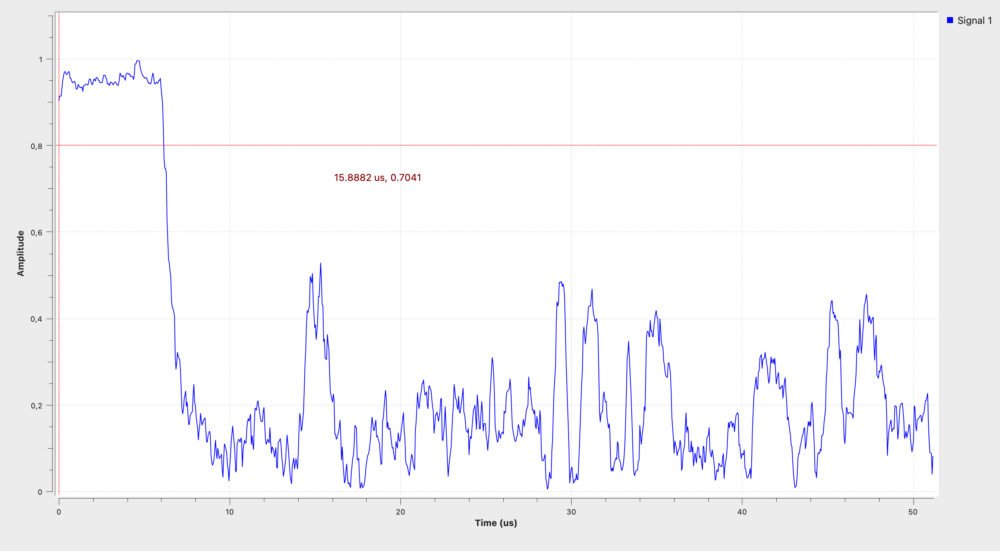
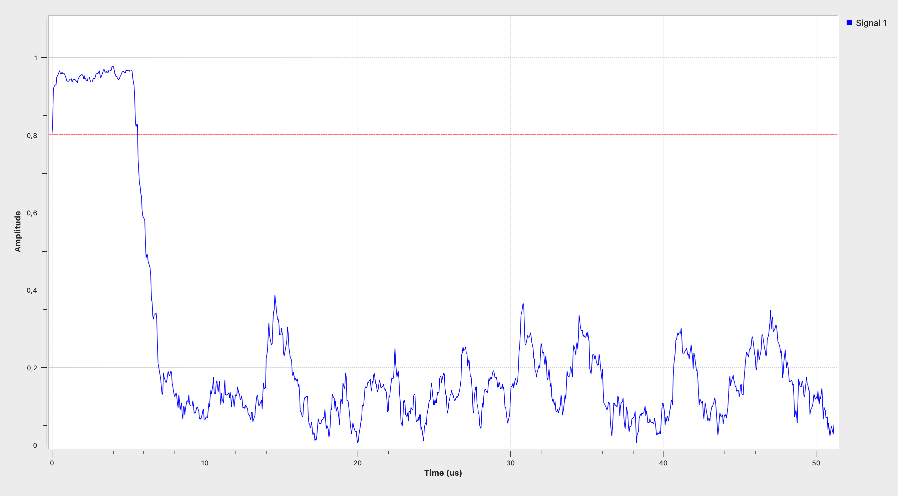
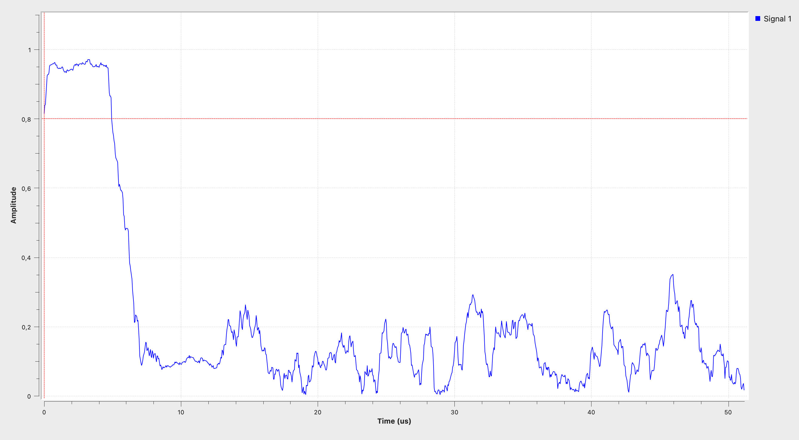

# SDR-PROJECT

Implementation of an **IEEE 802.11a OFDM receiver in GNU Radio**.

The receiver is developed progressively following the project guide and the receiver architecture presented in the reference paper. The first step is the detection of the beginning of an IEEE 802.11a frame using the periodicity of the short training sequence.

---

# Week 1 — IEEE 802.11a Parameters and Frame Detection

## 1. IEEE 802.11a OFDM Parameters

The first objective was to identify the main parameters of the IEEE 802.11a OFDM physical layer.

| Parameter | Value |
|---|---:|
| Channel bandwidth | 20 MHz |
| Sampling rate | 20 MS/s |
| FFT/IFFT size | 64 |
| Subcarrier spacing | 312.5 kHz |
| Total number of subcarriers | 64 |
| Used subcarriers | 52 |
| Data subcarriers | 48 |
| Pilot subcarriers | 4 |
| Useful OFDM symbol duration | 3.2 µs |
| Cyclic prefix duration | 0.8 µs |
| Total OFDM symbol duration | 4 µs |
| Useful symbol length | 64 samples |
| Cyclic prefix length | 16 samples |
| Total symbol length | 80 samples |

### Subcarrier spacing

The subcarrier spacing is obtained from:

**Δf = fs / NFFT**

With:

- fs = 20 MHz
- NFFT = 64

Therefore:

**Δf = 20 MHz / 64 = 312.5 kHz**

### Symbol duration

At a sampling rate of 20 MS/s, the sampling period is:

**Ts = 1 / fs = 50 ns**

The useful OFDM symbol contains 64 samples:

**64 × 50 ns = 3.2 µs**

The cyclic prefix contains 16 samples:

**16 × 50 ns = 0.8 µs**

Therefore, a complete OFDM symbol contains 80 samples and lasts:

**80 × 50 ns = 4 µs**

### Why are some subcarriers unused?

Not all 64 FFT bins carry useful information.

Among the 64 subcarriers:

- 48 carry data;
- 4 are pilot subcarriers;
- the remaining subcarriers are unused.

The unused subcarriers include the **DC subcarrier**, located at the center of the spectrum, and **guard subcarriers** located at the edges of the OFDM channel.

The guard subcarriers provide spectral separation from neighbouring channels, while the DC subcarrier is not used for data transmission.

---

## 2. IEEE 802.11a Frame Preamble

An IEEE 802.11a frame starts with a known preamble used by the receiver for detection and synchronization.

The first part is the **Short Training Field (STF)**.

The STF contains a **16-sample pattern repeated 10 times**.

Its total length is therefore:

**10 × 16 = 160 samples**

At 20 MS/s:

**160 × 50 ns = 8 µs**

The important property for frame detection is the periodicity of the STF:

**s[n] ≈ s[n + 16]**

During the STF, the received signal is therefore strongly correlated with a copy of itself delayed by 16 samples.

This property is used for frame detection.

---

## 3. GNU Radio Stream Tags — Section 2.1

GNU Radio stream tags are metadata attached directly to samples in a data stream. They can contain information such as the sampling frequency, carrier frequency or timestamps.

In the IEEE 802.11 receiver, tags are also used to propagate information about the received frame through the processing chain.

The OFDM Sync Long block determines the symbol alignment and tags the first OFDM symbol of each frame. This allows the following blocks to identify the beginning of the frame.

Later, after decoding the SIGNAL field, the OFDM Decode Signal block adds another tag containing the frame encoding scheme and frame length. This information is then used by the following decoding block to correctly process the payload.

Therefore, the tags mentioned in Section 2.1 are not separate blocks visible in the GNU Radio flowgraph. They are metadata attached to the sample stream and are generated and used by the synchronization and decoding blocks.

### Where are the mentioned tags?

Stream tags are **not separate signal connections in the GNU Radio flowgraph**.

Instead, they are attached to particular samples in the stream. They can be generated by a source or processing block, propagated through the receiver and read or modified by downstream blocks.

Therefore, there is no separate "tag wire" visible in GNU Radio Companion. The tags travel together with the sample stream.

For Week 1, the main objective is the processing of the complex I/Q samples. Tags become particularly useful when synchronization and frame information have to be propagated between later stages of the receiver.

---

# 4. Frame Detection — Section 2.2

The objective of Section 2.2 is to detect the short training sequence at the beginning of an IEEE 802.11a frame.

Since the STF repeats every 16 samples, the received signal is compared with a delayed version of itself.

## 4.1 Autocorrelation

The autocorrelation is calculated as:

**a[n] = sum of s[n+k] × conjugate(s[n+k+16]) over NWin samples**

where:

- s[n] is the received complex baseband signal;
- 16 is the repetition period of the short training sequence;
- NWin is the integration window length;
- conjugate(.) represents the complex conjugate.

During the STF:

**s[n] ≈ s[n + 16]**

Therefore, the magnitude of the autocorrelation becomes large.

### GNU Radio blocks used for the autocorrelation

The autocorrelation branch of the Week 1 flowgraph is implemented using:

**Delay (16) → Complex Conjugate → Multiply → Moving Sum → Complex to Mag**

In the implemented flowgraph, the moving sum is obtained using a FIR filter with:

```text
Taps = [1] * window_size
Decimation = 1
```

This performs the summation over the selected NWin samples.

---

## 4.2 Signal Power

The received signal power is calculated over the same integration window:

**p[n] = sum of |s[n+k]|² over NWin samples**

### GNU Radio blocks used for the power

The corresponding branch is:

**Complex to Mag² → Moving Sum**

The moving sum is again implemented using a FIR filter with:

```text
Taps = [1] * window_size
Decimation = 1
```

---

## 4.3 Normalized Autocorrelation

The autocorrelation is normalized using the received power:

**c[n] = |a[n]| / p[n]**

The normalization is important because detection should mainly depend on the **periodicity of the received signal**, rather than only on its absolute amplitude.

When the 16-sample repetition is present:

**c[n] approaches 1**

Outside the short training sequence, this periodicity is absent and the normalized autocorrelation becomes significantly smaller.

A plateau close to 1 can therefore be used to identify the beginning of an IEEE 802.11a frame.

---

# 5. GNU Radio Implementation

For offline receiver development, a provided recording of real IEEE 802.11a baseband I/Q samples was used.

The experiment presented here uses:

```text
Sample1_20MHz_Channel36.bin
```

The recording has a sampling rate of:

**fs = 20 MS/s**

The input chain is:

**File Source → Throttle**

The `Throttle` block is configured at 20 MS/s to prevent the file from being processed as fast as the computer allows.

The signal is then divided into two branches:

### Autocorrelation branch

**Signal → Delay (16) → Complex Conjugate → Multiply → Moving Sum → Complex to Mag**

### Power branch

**Signal → Complex to Mag² → Moving Sum**

Finally, the two quantities are divided:

**c[n] = |a[n]| / p[n]**

The result is displayed using a `QT GUI Time Sink`.

The complete GNU Radio flowgraph is available in:

```text
Week1/week1_frame_detection.grc
```

---

# 6. Frame Detection Results

The next experiment investigates the effect of the integration-window length **NWin**.

Three values were tested:

- NWin = 32
- NWin = 48
- NWin = 64

A threshold of **0.8** is displayed in red on the figures to make the high-correlation region easier to identify.

The horizontal axis is expressed in time.

Since the sampling rate is 20 MHz:

**1 sample = 0.05 µs**

The absolute horizontal position of the plateau does not need to be identical to Figure 2 of the reference paper. The QT GUI Time Sink displays a selected portion of the sample stream, so the origin of the displayed time axis depends on the displayed window.

The important observations are the **high normalized correlation during the repeated training sequence and the clear decrease when the periodic structure ends**.

---

## 6.1 NWin = 32



With **NWin = 32**, a clear high-correlation region appears at the beginning of the displayed interval.

The normalized autocorrelation remains approximately between 0.9 and 1 during the plateau and is therefore clearly above the detection threshold of 0.8.

When the repeated short-training structure ends, the correlation decreases sharply below the threshold.

However, after this transition, relatively large fluctuations remain visible. Several peaks can be observed outside the high-correlation region.

This is consistent with the use of a shorter integration window. Fewer samples contribute to each correlation estimate, providing good temporal localization but less averaging of local variations.

---

## 6.2 NWin = 48



With **NWin = 48**, the beginning of the displayed interval again produces a very clear plateau close to 1.

The normalized autocorrelation remains well above the 0.8 threshold during this region and then falls rapidly below the threshold.

Compared with NWin = 32, the values outside the high-correlation region are generally less irregular.

The separation between the detected region and the rest of the signal is therefore very clear.

NWin = 48 provides a good compromise between:

- maintaining a clearly localized transition;
- reducing fluctuations;
- obtaining a stable high-correlation plateau.

For this reason, **NWin = 48 is retained for the final Week 1 implementation**.

This is also the integration-window value reported as working well in the reference receiver implementation.

---

## 6.3 NWin = 64



With **NWin = 64**, the high-correlation region remains clearly visible and reaches values close to 1.

Increasing the integration window means that more samples contribute to each correlation estimate.

The values outside the plateau are generally smoother and the fluctuations are reduced compared with the shorter integration window.

However, using a larger window also increases temporal averaging. The transitions are therefore averaged over a larger number of samples.

NWin = 64 provides stronger smoothing, but with reduced temporal localization compared with a shorter integration window.

---

# 7. Comparison of NWin

The three experiments illustrate the trade-off introduced by the integration-window length.

| NWin | Main observation |
|---:|---|
| 32 | Good temporal localization, but larger fluctuations outside the STF |
| 48 | Clear plateau and good compromise between smoothing and localization |
| 64 | Stronger smoothing, but more temporal averaging |

The experiments show why an intermediate integration-window length is useful.

The final Week 1 implementation therefore uses:

**NWin = 48**

---

# 8. Week 1 Conclusion

Week 1 established the main parameters of the IEEE 802.11a OFDM physical layer and implemented the first operation of the receiver: **frame detection**.

The 16-sample periodicity of the Short Training Field allows the beginning of a frame to be detected using normalized autocorrelation.

The GNU Radio implementation computes:

1. the correlation between the received signal and a version delayed by 16 samples;
2. the received power over the same integration window;
3. the normalized metric:

**c[n] = |a[n]| / p[n]**

Using the provided 20 MHz IEEE 802.11a I/Q recording, a clear high-correlation plateau was obtained.

The influence of the integration-window length was investigated experimentally using NWin = 32, 48 and 64.

The results show that increasing NWin provides stronger averaging, while a shorter window provides better temporal localization.

Based on these results, **NWin = 48** is retained as a good compromise for the following receiver stages.

---
# Week 2 — IEEE 802.11a Frame Synchronization and Short Sync Block

## 1. Introduction to the OFDM Sync Short Block
Following the frame detection phase established in Week 1, the next major objective of the receiver is to transition from raw metric visualization to actual automated frame synchronization using the **OFDM Sync Short** block (or `WiFi Sync Short` depending on the version of the OOT module).

While the previous stage generated a continuous normalized autocorrelation metric $c[n]$ to highlight the Short Training Field (STF), this block acts as the core control mechanism of the receiver pipeline. It evaluates the incoming metric against a defined threshold, identifies the precise start of a valid frame, inserts metadata stream tags (`wifi_start`), and gates the downstream processing chain to handle incoming packets.

---

## 2. Understanding the OFDM Sync Short Block
The **OFDM Sync Short** block performs several critical functions within the IEEE 802.11a physical layer receiver:

* **Trigger and Gated Mechanism:** It monitors the normalized correlation metric $c[n]$ provided by the divide block.
* **Tag Generation:** When the metric crosses the specified threshold and satisfies plateau requirements, the block injects a stream tag (`wifi_start`) into the sample stream. This tag travels downstream to inform subsequent blocks (such as long synchronization and decoding stages) where the packet boundary begins.
* **Stream Alignment:** It ensures that the raw complex baseband samples are properly aligned with the detected frame timing before passing them to the Fourier transform and equalization stages.

---

## 3. Meaning of the Thresholds
The performance of the synchronization block relies heavily on its configuration parameters, with the **Threshold** being the most critical:

* **Definition:** The threshold represents the minimum normalized correlation value ($c[n]$) required to register a potential frame start. In our GNU Radio configuration, it is typically set around $0.8$ (or `800m`).
* **Operational Role:** It establishes the decision boundary between random background noise/interference and a legitimate IEEE 802.11a preamble transmission.
* **Min Plateau Parameter:** Working alongside the threshold, parameters like `Min Plateau` ensure that the metric remains above the threshold for a minimum number of consecutive samples, preventing single-sample noise spikes from triggering false synchronization events.

---

## 4. Exploration of Threshold Sensitivity
To understand how the threshold affects receiver behavior, experiments were conducted by varying its value relative to the default setting of $0.8$:

### 4.1 Increasing the Threshold (e.g., to $0.95$)
* **Behavior:** The receiver becomes extremely strict. It requires near-perfect correlation matching the ideal STF structure.
* **Impact:** While false alarms due to noise are completely eliminated, many legitimate frames experiencing minor channel degradation, multipath fading, or low Signal-to-Noise Ratio (SNR) fail to cross the high barrier. This results in **missed packet detections** and a significant drop in packet reception rate.

### 4.2 Decreasing the Threshold (e.g., to $0.50$)
* **Behavior:** The receiver becomes overly permissive and sensitive.
* **Impact:** Minor fluctuations in background noise, adjacent channel interference, or multipath reflections frequently exceed the low threshold. This leads to **false positives**, where the system falsely identifies noise bursts as valid frames, triggering downstream decoding errors and wasting processing resources on invalid data.

---

## 5. Limitations and Breakdown Scenarios
Despite its simplicity and effectiveness under clean test conditions, the autocorrelation-based short synchronization approach has inherent structural limitations:

### 5.1 The Blind Spot / Processing Dead Time Limitation
Once the **OFDM Sync Short** block detects a valid peak and triggers synchronization, it enters an active state where it locks onto the detected frame, processes a fixed number of samples, and forwards them.

* **The Breakdown Case:** If a high-density traffic scenario occurs—where a second IEEE 802.11a frame arrives closely following or overlapping the first one while the block is still busy handling the initial packet—the synchronization block is **blind to the second frame**.
* **Consequence:** The second frame is completely ignored or truncated because the block's internal state machine cannot re-trigger during active processing of the current packet. This demonstrates the limitation of a purely threshold-triggered sequential sync block under heavy burst traffic conditions.

---

## 6. Week 2 Conclusion
Week 2 successfully transitioned the receiver from open-loop metric visualization to closed-loop automated frame synchronization:

* The **OFDM Sync Short** block was integrated and analyzed, demonstrating its role as the gatekeeper of the receiver chain.
* The impact of the detection threshold was evaluated, proving that $0.8$ serves as an optimal compromise between false alarms and missed detections.
* The operational limitations of threshold-based autocorrelation were identified, specifically highlighting vulnerability to closely spaced burst packets where the system becomes temporarily unresponsive to subsequent frames.
# Repository Structure

```text
SDR-PROJECT/
│
├── README.md
│
└── Week1/
    ├── week1_frame_detection.grc
    └── Results/
        ├── NWin32.png
        ├── NWin48.png
        └── NWin64.png
```
